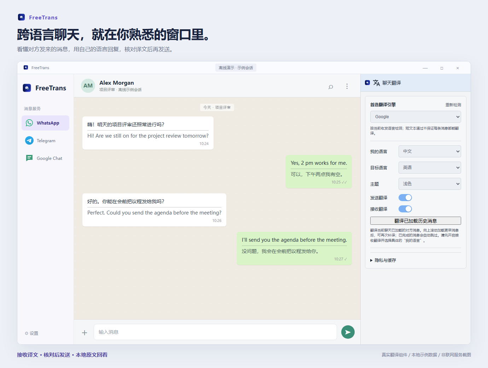
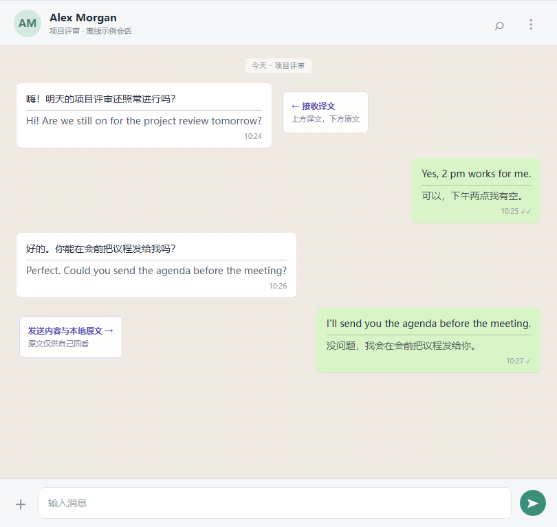
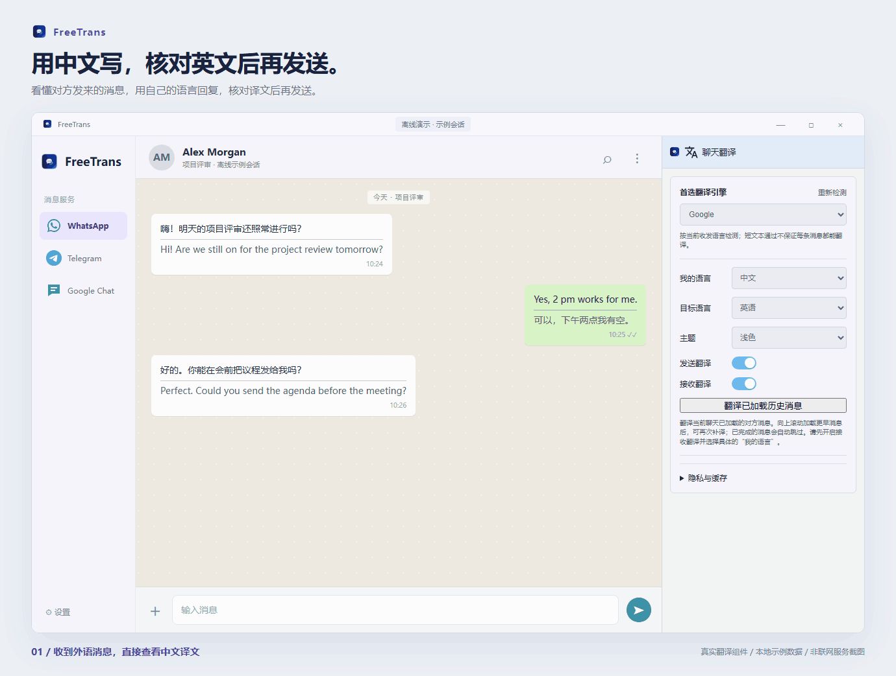
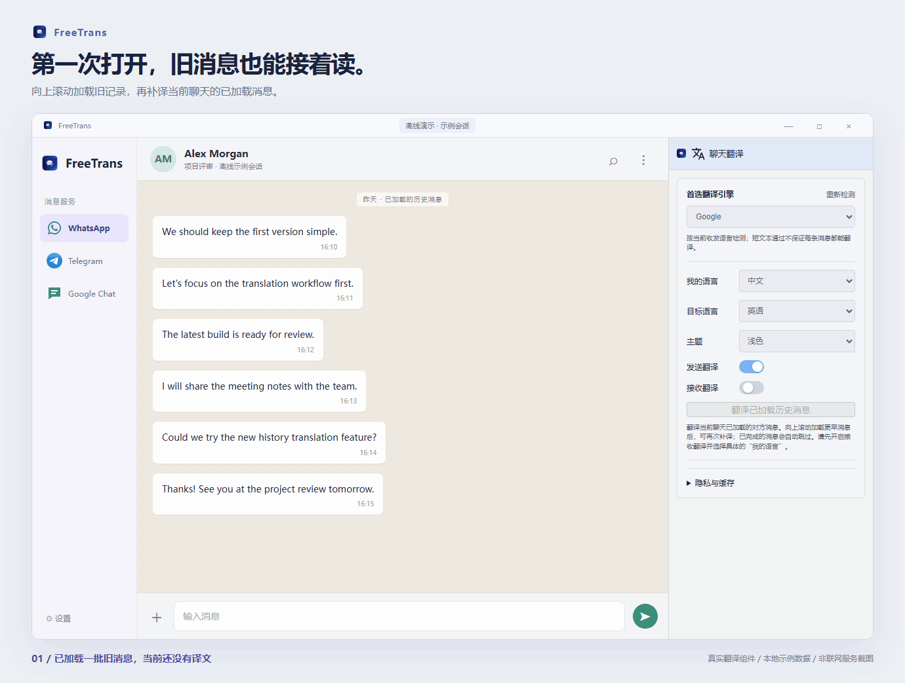

<p align="center">
  
</p>

<h1 align="center">FreeTrans</h1>
<p align="center"><strong>在熟悉的聊天服务里，读懂对方，表达自己。</strong></p>
<p align="center">
  <a href="https://github.com/gcc-luo/FreeTrans/releases">下载桌面版</a> ·
  <a href="#快速开始">快速开始</a> ·
  <a href="#支持的服务">服务支持</a> ·
  <a href="https://github.com/gcc-luo/FreeTrans/issues">反馈问题</a>
</p>



FreeTrans 是一款基于 Electron 的桌面聊天翻译工具，为 WhatsApp、Telegram 和 Google Chat 的网页会话提供翻译入口。收到外语消息时查看译文，用自己的语言写下回复，再核对将要发送给对方的内容。

它基于 [Ferdium](https://github.com/ferdium/ferdium-app) 的服务集成能力开发，产品重点是**跨语言沟通中的消息翻译**。

> 图片与动图取自本地离线演示：复用项目真实的翻译面板、样式和消息拦截器，聊天页面、联系人及翻译返回使用示例数据，并非真实 WhatsApp 联网页面截图。下文描述当前 `main` 分支的能力；已发布安装包请以对应 Release 的发行说明为准。

## 为什么使用 FreeTrans

- **在聊天中读译文**：收到消息后直接查看翻译结果，减少在聊天窗口和翻译工具之间来回复制。
- **发送前看清内容**：核对原文与译文，允许修改或取消；翻译失败时保留草稿或提供原文恢复入口。
- **不同聊天使用不同语言**：为服务选择默认语言；WhatsApp 还支持当前会话的目标语言覆盖。
- **从新消息延伸到旧消息**：WhatsApp 支持手动补译已加载的历史消息，并显示处理进度。
- **自己选择翻译服务**：选择可用引擎，查看实际使用的引擎，并管理本机翻译缓存。

## 翻译在消息里，原文也能回看



_接收消息的译文与原文一起显示；发送后可在自己的消息气泡中查看本地保留的原文。图中的紫色标注用于文档说明，不属于应用界面。_

## 支持的服务

| 能力                     | WhatsApp Web         | Telegram Web           | Google Chat      |
| ------------------------ | -------------------- | ---------------------- | ---------------- |
| 收到的文字消息翻译       | 支持                 | 支持 Web K / A         | 支持             |
| 发送前翻译、编辑与确认   | 支持                 | 支持                   | 支持             |
| 按服务设置语言与收发开关 | 支持                 | 支持                   | 支持             |
| 当前会话单独保存目标语言 | 支持                 | 暂未提供               | 暂未提供         |
| 手动历史补译与进度显示   | 支持已加载的对方消息 | 暂未提供专用入口       | 暂未提供专用入口 |
| 发送原文的本地记录与恢复 | 支持，受缓存设置影响 | 发送后提供临时原文预览 | 支持本地原文记录 |

这里的服务支持指 FreeTrans 内嵌的网页会话，不是控制系统中另行安装的聊天客户端。网页更新可能影响消息识别；复杂消息格式仍需按具体场景验证。语音翻译、图片文字识别和视频翻译不在本页承诺的功能范围内。

## 下载与安装

前往 [GitHub Releases](https://github.com/gcc-luo/FreeTrans/releases)，按系统和处理器选择安装包：

| 系统                | 安装包          |
| ------------------- | --------------- |
| Windows x64         | `.exe` 安装程序 |
| macOS Apple Silicon | ARM64 `.dmg`    |
| macOS Intel         | x64 `.dmg`      |

当前发布流水线构建 Windows 和 macOS 安装包；Linux 尚未纳入这条发布流水线。macOS 安装包的签名状态以具体发布为准，临时签名不等于 Developer ID 签名或公证。

应用内可检查更新，并打开浏览器下载安装包，由用户完成安装。发布和更新机制见 [桌面端发布说明](./docs/github-desktop-release.md)。

## 快速开始

1. **添加聊天服务**：在服务列表中添加 WhatsApp、Telegram 或 Google Chat。
2. **登录服务**：在内嵌页面中完成对应服务的扫码或账号登录。
3. **打开翻译面板**：选择“我的语言”和“对方语言”，再选择当前可用的翻译引擎。
4. **开启需要的翻译方向**：接收翻译用于读消息；发送翻译用于生成发给对方的译文。
5. **开始聊天**：收到消息后查看译文；发送时核对实际内容，再确认发送。

“我的语言”是收到消息时希望读到的语言；“对方语言”是发送翻译的默认目标语言。接收翻译和历史补译需要选择具体的“我的语言”。

如果引擎列表为空，先点击“重新检测”。需要凭据的引擎可到 **设置 → 语言** 中配置；一次短文本检测成功不代表所有消息都能翻译。

## WhatsApp：发送前先核对



_约 8 秒循环演示：中文草稿 → 英文预览 → 编辑译文 → 确认发送。_

输入草稿并触发发送后，FreeTrans 会生成译文，在输入框附近显示预览。你可以修改译文、取消操作，或确认发送。预览中的语言选择也可以为当前聊天保存目标语言，其他聊天继续使用各自的设置。

发送流程会检查会话、语言设置和草稿是否发生变化。快速连续发送仍逐条进入翻译流程；发送结果不明时显示恢复提示，避免自动重复触发。观察到新消息气泡只用于本地确认，不代表对方已经收到或已读。

自己的消息气泡可显示本地保留的原文，方便回看；本地显示的原文不作为额外消息发送给对方。

## WhatsApp：第一次打开，旧消息怎么办



_约 7 秒循环演示：一批旧消息补译完成后，再次执行会跳过已完成的消息。_

新消息和可见消息会按接收翻译设置处理。需要阅读更早的聊天内容时：

1. 打开目标聊天，向上滚动，等待 WhatsApp 加载旧消息。
2. 在翻译面板点击 **“翻译已加载历史消息”**。
3. 查看已处理、翻译、跳过与失败的数量。失败消息可再次补译，已有结果会自动跳过。
4. 需要更早记录时，继续向上滚动加载，再执行下一批补译。

补译范围是**当前聊天页面中已加载、可识别的对方消息**。它不会一次拉取账号的全部历史聊天，也不会自动滚动页面遍历所有记录。历史任务可停止；切换聊天或修改相关语言设置会取消旧任务，在途结果会被丢弃。批量补译期间，新收到的消息仍优先处理。

## 翻译引擎与隐私

可配置的翻译引擎包括 Google、百度、网易有道、阿里云、LibreTranslate 和 MyMemory。实际可用性取决于语言组合、网络与凭据配置；部分引擎失败后会尝试备用服务，面板显示实际使用的引擎或缓存来源。

| 数据               | 处理方式                                           |
| ------------------ | -------------------------------------------------- |
| 待翻译文本         | 会发送给所选翻译服务；触发回退时可能发送给备用服务 |
| 翻译结果与发送原文 | 默认在本机按服务缓存，保留时间最多 7 天            |
| 缓存控制           | 可关闭新缓存，或清除当前服务及全部服务的缓存       |
| 历史原文预览       | 依赖本地记录；关闭或清除缓存后可能无法恢复         |

翻译需要把可读文本交给翻译服务处理，请按聊天内容选择适合的引擎与缓存设置。手动历史补译同样遵循这些规则。

## 常见问题

**聊天服务一直连接或显示 `ERR_TIMED_OUT`？**

先用浏览器检查对应服务网页是否可访问，再确认网络或代理对 FreeTrans 生效。聊天页面能否加载，与翻译引擎能否连接是两条不同的链路。

**有些消息没有译文？**

检查接收翻译开关、具体的“我的语言”和引擎状态。已是目标语言、无需变化的内容可能被跳过；旧记录需要先在页面加载。翻译失败的消息可点击重试。

**第一次安装，能恢复之前发送消息的中文原文吗？**

只有本机已经保存过的原文记录才能恢复。首次使用前的发送消息，不能靠本地缓存还原当时输入的草稿。

**能批量翻译账号里所有联系人的全部记录吗？**

当前历史补译针对正在打开的聊天页面，不提供账号级全量抓取或离线聊天记录导入。

**如何反馈识别或发送问题？**

提交 [Issue](https://github.com/gcc-luo/FreeTrans/issues) 时附上系统、应用版本、聊天服务、语言组合、引擎与复现步骤。截图中的联系人、消息内容和凭据请先遮盖。

## 本地开发

项目指定 **Node.js 22.18.0** 和 **pnpm 10.14.0**；以 [package.json](./package.json) 为准。

```bash
git clone https://github.com/gcc-luo/FreeTrans.git
cd FreeTrans
pnpm install --frozen-lockfile
pnpm start:all-dev
```

`start:all-dev` 会启动开发构建服务，等待就绪后打开 Electron 桌面端。

```bash
# 安装测试浏览器，并运行三个服务的模拟端到端测试
pnpm exec playwright install chromium
pnpm exec playwright test test/e2e/messageTranslator

# 运行 WhatsApp 翻译相关单元测试
pnpm exec jest test/features/messageTranslator/WhatsAppInterceptorScript.test.ts test/features/messageTranslator/LanguageSendFlow.test.ts --runInBand

# 类型检查
pnpm typecheck
```

端到端测试使用模拟页面和翻译接口，覆盖正常流程、失败保留草稿、连续发送、会话隔离、历史补译和停止操作；它们不能替代真实登录环境下的兼容性测试。当前代码仍有已知类型检查错误，运行检查时请以实际输出为准。

图片与动图的录制源码、演示数据及重新生成方法见 [README 素材说明](./docs/readme/README.md)。素材在本地离线生成，不需要聊天账号或翻译引擎凭据。

## 贡献与上游致谢

欢迎通过 [Issues](https://github.com/gcc-luo/FreeTrans/issues) 报告问题，或提交围绕聊天翻译的改进。开发约定见 [AGENTS.md](./AGENTS.md)；更完整的环境资料见 [贡献指南](./贡献指南.md)，其中仍包含 Ferdium 上游背景说明。

感谢 [Ferdium](https://github.com/ferdium/ferdium-app) 及其贡献者提供多服务集成与桌面架构基础。FreeTrans 在此基础上持续完善跨语言聊天体验。项目使用 Apache-2.0 许可证，具体授权与上游声明见 [许可证](./许可证.md)。
